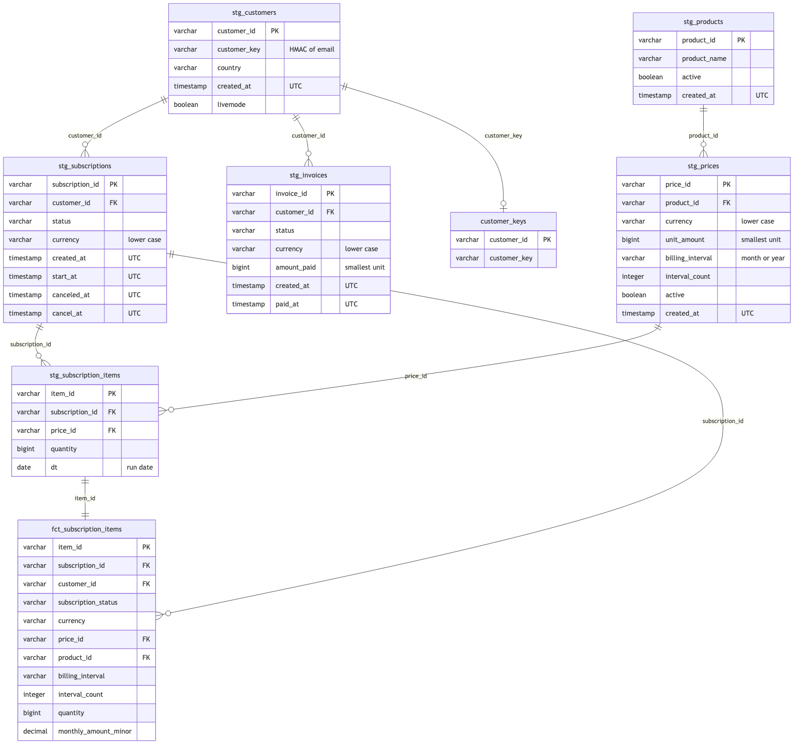
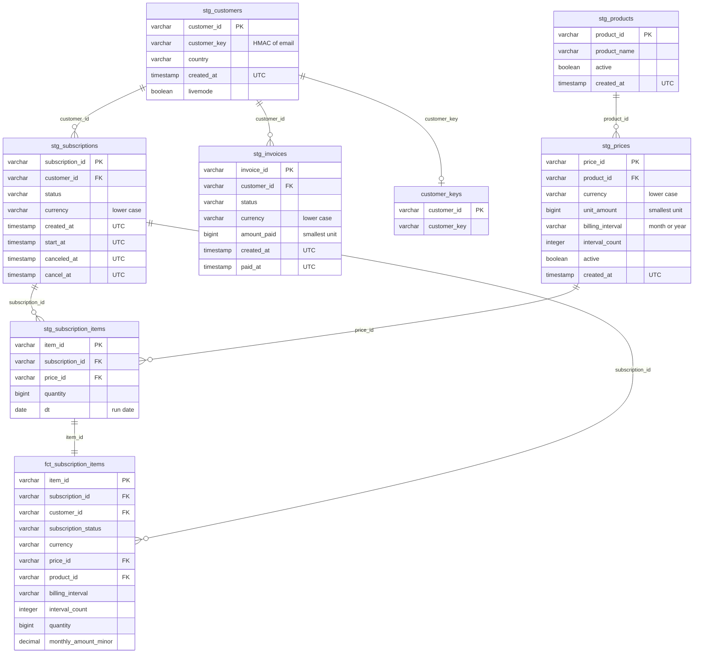

# Schema: entity relationship diagram

Built from the dbt models as they are in V1. Staging and marts are shown here. The raw tables
(`raw_<endpoint>`) keep each Stripe object as text in `payload`, so they are not drawn.
Personal fields (name, email, phone, address lines) are not in staging, so they do not appear.

Arrows mean "one to many": one customer has many subscriptions, and so on.

## Marts (aggregates, no row-level personal data)

| Mart | Grain | Built from |
|---|---|---|
| `mart_mrr` | one row per currency | `fct_subscription_items`, active and trialing only |
| `mart_active_subscriptions_by_plan` | product, price, currency, interval | `fct_subscription_items` |
| `mart_revenue_by_month` | UTC month of payment, currency | `stg_invoices` (status `paid`), with `currency_decimals` |
| `mart_cancellations_by_month` | UTC month of cancellation, currency | `stg_subscriptions` |

`currency_decimals` (a seed, not drawn) maps each currency to its decimal places.
